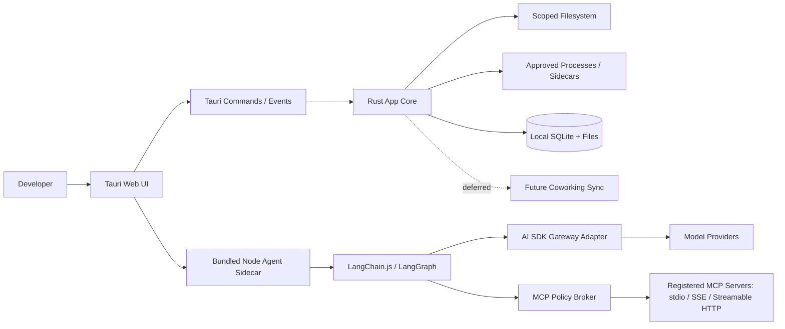
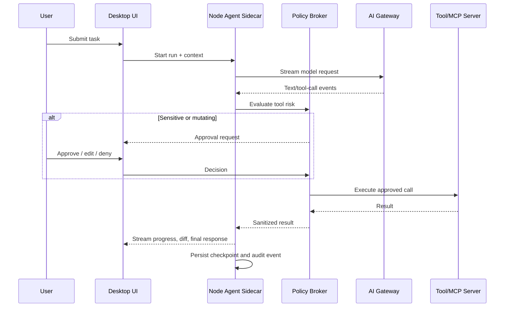

# Architecture

## 1. Principles

1. Local-first, explicit cloud boundary.
2. UI never receives unrestricted native capabilities.
3. Agent plans are separate from mutations.
4. Every side effect has an owner, policy decision, and audit event.
5. Static project context and runtime tool results remain distinguishable.
6. Providers are replaceable behind stable contracts.

## 2. System context

## 3. Deployment topology

### Tauri shell

Rust owns native windows, scoped filesystem operations, process lifecycle, secure storage integration, and event transport. The web UI owns presentation and interaction state.

### Agent runtime

The agent runtime is a bundled Node sidecar. It is a TypeScript service boundary rather than provider SDK logic inside Rust. Tauri starts, monitors, and terminates the sidecar through an explicit sidecar protocol. The sidecar must not receive arbitrary UI-originated commands; it receives typed run requests and emits typed events.

The sidecar distribution is a self-contained platform-specific executable produced from the TypeScript service. The app must not require the user to install Node.js.

### Storage

- SQLite: projects, profiles, runs, approvals, MCP registrations, audit metadata, and encrypted non-secret settings metadata.
- Project files: source, `.coworking/` settings, agent instructions, and optional local manifests.
- OS keychain: gateway/API credentials, MCP secrets, and sidecar authentication material.
- Append-only audit records: sanitized request metadata and action outcomes.
- No cloud synchronization in the current release; all application state stays on the local machine.

## 4. Runtime boundaries

| Boundary | Responsibility | Trust rule |
|---|---|---|
| UI to Tauri | User intent and rendered state | Validate command payloads and capability scope |
| Tauri to filesystem | Read/write project files | Allowlisted roots only |
| Tauri to process | Terminal and sidecar execution | Explicit command policy and approval |
| Agent to gateway | Model generation/streaming | Redact secrets and record model policy |
| Agent to MCP broker | Tool discovery/calls | Broker enforces risk and approval |
| Broker to MCP server | External tool execution | Server is untrusted local code |
| Local to future sync | Coworking metadata | Never sync source/secrets by default |

## 5. Agent execution model

LangChain.js `createAgent` is the orchestration entry point. Middleware handles summarization, limits, human-in-the-loop interrupts, and policy checks. A checkpointer provides resumability per `thread_id`/run.

AI SDK supplies a normalized model interface and streaming events. The gateway adapter owns model aliases, provider credentials, routing, usage, timeout, and budget policy. The agent does not directly depend on a specific provider.

## 6. Tauri capability model

Use Tauri v2 capabilities and explicit plugin scopes. Filesystem permission identifiers alone are not sufficient; path scopes must be explicit. Shell sidecars require explicit permission. Prefer Rust commands for sensitive compound operations so policy checks are centralized.

Recommended commands:

- `project_open`, `project_list_recent`, `project_read_file`, `project_write_patch`
- `terminal_start`, `terminal_input`, `terminal_cancel`
- `agent_start`, `agent_cancel`, `agent_resume`, `agent_approve`
- `mcp_register`, `mcp_disable`, `mcp_list_tools`, `mcp_call`
- `settings_get`, `settings_update`, `diagnostics_export`

## 7. Editor and VS Code relationship

The product adopts VS Code's familiar layout and interaction conventions but does not assume it can ship the entire VS Code workbench. Monaco Editor is the MVP editor foundation. A thin internal editor adapter must isolate Monaco APIs from tabs, persistence, diagnostics, diff views, and future editor replacement. Language Server Protocol and tree-sitter integrations remain separate services around the editor. Any direct reuse of VS Code components must pass a license and runtime review.

Monaco is an editor foundation, not the complete VS Code extension host. Extension compatibility is explicitly out of scope until a separate technical spike validates runtime, licensing, and API coverage.

## 8. Security controls

- Project root allowlist and path traversal rejection.
- Separate read, write, execute, delete, network, and secret capabilities.
- Default-deny MCP registration until reviewed.
- Approval required for mutating or externally observable actions.
- Tool arguments shown before execution; redact known secret patterns.
- Process limits: timeout, output cap, working directory, environment allowlist.
- Prompt/context boundary labels: user input, repository content, tool output, model output.
- Audit every approval and execution, including failures and cancellation.
- MCP transport policy must apply consistently to stdio, SSE, and Streamable HTTP.
- HTTP MCP servers require origin/endpoint allowlisting, connection timeouts, response limits, and explicit network disclosure.

## 9. Failure handling

The UI renders explicit states: queued, streaming, waiting for approval, running tool, succeeded, failed, cancelled, interrupted, and unknown. Provider failure must not be silently retried when a tool call may have side effects. Resume requires the checkpoint and a fresh policy evaluation.

## 10. Observability

Record correlation IDs across UI action, agent run, model request, tool call, process, and audit event. Store timing, token usage, selected model alias, policy version, and outcome. Do not store raw secrets or unrestricted prompts by default.

## 11. MCP compatibility policy

MVP targets the latest stable official MCP TypeScript SDK available when implementation begins. Exact package versions are committed in the lockfile and recorded in a compatibility matrix. The broker supports stdio, SSE, and Streamable HTTP through adapters that normalize discovery, calls, cancellation, timeout, and errors.

Every transport passes the same policy checks. HTTP transports additionally require endpoint allowlisting, TLS policy, connection limits, and response-size limits.

## 12. Gateway adapter

The agent sidecar talks to an internal `ModelGateway` interface. The first adapters are:

- `HostedGatewayAdapter`: connects to a managed AI SDK-compatible gateway.
- `SelfHostedGatewayAdapter`: connects to an organization-controlled gateway URL.

Both adapters expose the same streaming text, tool-call, usage, error, and cancellation events. Credentials are loaded from the OS keychain and are never passed through the renderer.

## 13. Future sync boundary

The coworking sync interface is deliberately deferred. Local project, profile, team, presence, and audit records are authoritative on the device for the current release. No sync client, remote account, or background upload is enabled by default.
