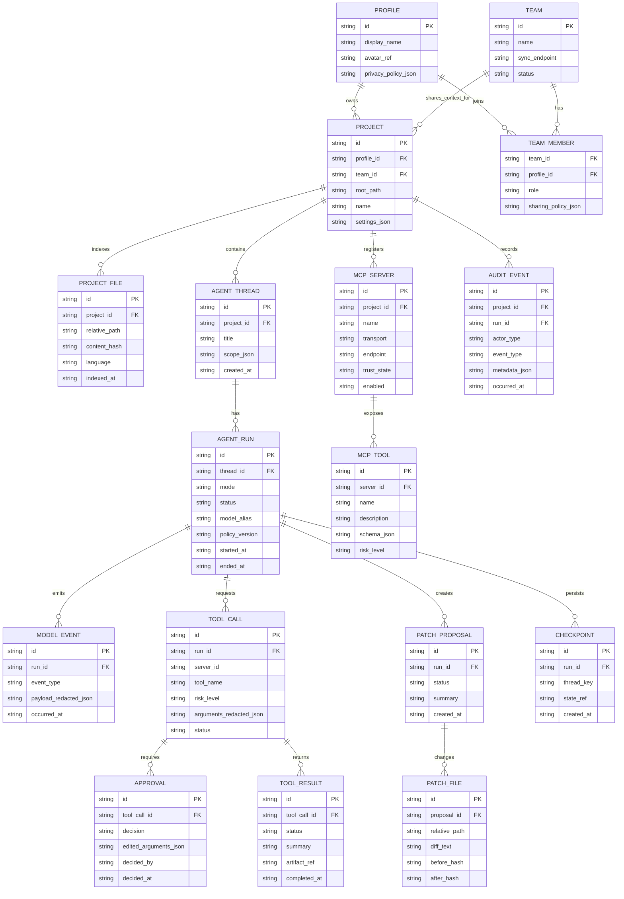

# Entity Relationship Diagram

## Data rules

- `PROJECT.root_path` is local and never synchronized by default.
- `MCP_TOOL.schema_json` is untrusted input and must be rendered safely.
- `PATCH_FILE.before_hash` must match before application.
- `APPROVAL` is immutable after decision; corrections create a new event.
- `AUDIT_EVENT.metadata_json` is sanitized and size-bounded.
- Delete operations are soft-deleted in metadata and physically confirmed separately.
